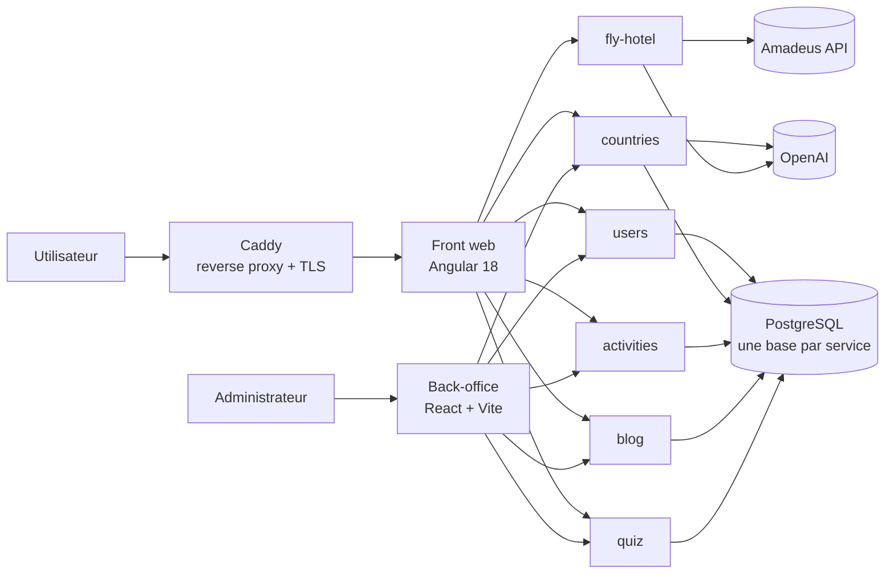

# Wonders — Plateforme de planification de voyages

> Projet de fin de Master (Grand Projet ETNA), réalisé en équipe de 6 développeurs entre mai 2024 et septembre 2025.

Wonders aide un voyageur à préparer son séjour de A à Z : découvrir un pays, trouver des activités, rechercher vols et hôtels, sauvegarder son itinéraire et échanger avec la communauté. L'application repose sur une **architecture microservices** en Node.js / TypeScript, un **front Angular**, un **back-office React** et une **CI GitLab** qui teste chaque service à chaque merge request.

<!-- Ajouter ici une capture d'écran ou un GIF de l'application -->
<!-- Démo : https://web.wonders-travel.fr (à indiquer seulement si elle est en ligne) -->

---

## Ma contribution

<!-- Section à relire et compléter : c'est la partie que les recruteurs lisent en premier. -->

Développeur fullstack à dominante front-end (plus de 100 commits) :

- **Front Angular** : développement de nombreux composants de l'application web, refonte UX/UI
- **Sauvegarde de voyage** : fonctionnalité permettant à l'utilisateur d'enregistrer et retrouver ses itinéraires
- **Intégration Google Maps**, des pages hôtels et du chat
- **Signalement de bugs** par les utilisateurs depuis l'interface
- **Authentification** : gestion de l'expiration des tokens JWT, middleware de vérification utilisateur, routes du service `users`
- Corrections sur le service `countries`
- Sécurisation des variables d'environnement dans les images Docker

---

## Architecture



| Service | Rôle |
|---|---|
| `users` | Inscription, connexion, profils, rôles utilisateur / admin |
| `countries` | Pays et villes, descriptions générées par IA |
| `activities` | Activités, catégories, photos, notes et avis |
| `blog` | Sujets, topics et commentaires de la communauté |
| `quiz` | Questionnaire de préférences pour orienter le voyageur |
| `fly-hotel` | Recherche de vols et d'hôtels via l'API Amadeus |

Chaque microservice est indépendant : son propre code, sa propre base PostgreSQL, ses migrations, son Dockerfile et son pipeline CI. En production, Caddy expose chaque service sur un sous-domaine dédié avec TLS automatique.

---

## Stack technique

**Back-end** : Node.js, Express, TypeScript, Sequelize (migrations + seeders), PostgreSQL, Swagger

**Front-end** : Angular 18, Angular Material, Tailwind CSS, ngx-translate (i18n), Google Maps, Firebase, Tauri (version desktop)

**Back-office** : React, Vite, TanStack Table, React Hook Form + Zod, Recharts, Radix UI

**IA et API externes** : OpenAI (gpt-4o-mini), Amadeus

**Infra et qualité** : Docker, Docker Compose, Caddy, GitLab CI, Jest, Bruno (tests d'API), ESLint, Prettier

---

## Points techniques notables

**IA avec mise en cache.** La description d'un pays est générée par OpenAI puis stockée en base. Lors d'une consultation, elle n'est régénérée que si elle date de plus de 29 jours, ce qui limite les coûts et la latence.

**Limitation de débit.** Un rate limiter à file d'attente encadre les appels aux API externes pour respecter leurs quotas.

**Sécurité de l'authentification.** Mots de passe hachés avec Argon2, robustesse vérifiée avec zxcvbn, authentification JWT, middlewares distincts pour les accès utilisateur et administrateur, emails transactionnels via Nodemailer.

**CI par microservice.** À chaque merge request, GitLab CI enchaîne pour chaque service :
1. **lint** (ESLint)
2. **test** : base PostgreSQL réelle, migrations et seeders appliqués, service démarré, puis exécution des collections d'API [Bruno](https://www.usebruno.com/) (plus de 200 requêtes, sur 200 itérations)
3. **build** (bundle esbuild pour les services, build Angular pour le front)

Le workflow d'équipe était encadré par des règles de branches (`back_dev`, `dev_web` → `main`) et des templates d'issues et de merge requests.

---

## Lancer le projet en local

**Prérequis** : Docker et Docker Compose. Les fonctionnalités IA nécessitent une clé OpenAI.

```bash
git clone https://github.com/GrenteGlenn/wonders.git
cd wonders
export OPENAI_API_KEY="votre_clé"
docker compose up --build
```

| Service | URL locale |
|---|---|
| Front web | http://localhost:8000 |
| activities | http://localhost:3000 |
| blog | http://localhost:3001 |
| countries | http://localhost:3002 |
| fly-hotel | http://localhost:3003 |
| quiz | http://localhost:3004 |
| users | http://localhost:3005 |
| PostgreSQL | localhost:5433 |

Les bases sont initialisées automatiquement à partir des scripts du dossier `init/`.

---

## Structure du dépôt

```
wonders/
├── back/
│   ├── users_wonders/        # un dossier par microservice
│   ├── countries_wonders/
│   ├── activities_wonders/
│   ├── blog_wonders/
│   ├── quiz_wonders/
│   ├── fly_hotel_wonders/
│   └── back_office/          # back-office React
├── front/wonders-web/        # application Angular
├── ci/                       # jobs GitLab CI (lint, test, build, docker)
├── init/                     # scripts d'initialisation des bases
├── docker-compose.yaml
└── Caddyfile                 # reverse proxy de production
```

---

## Équipe

Projet réalisé à 6 dans le cadre du Master ETNA « Architecte logiciel et développeur d'application ».

<!-- Optionnel : ajouter les liens GitHub/LinkedIn des coéquipiers qui sont d'accord -->
